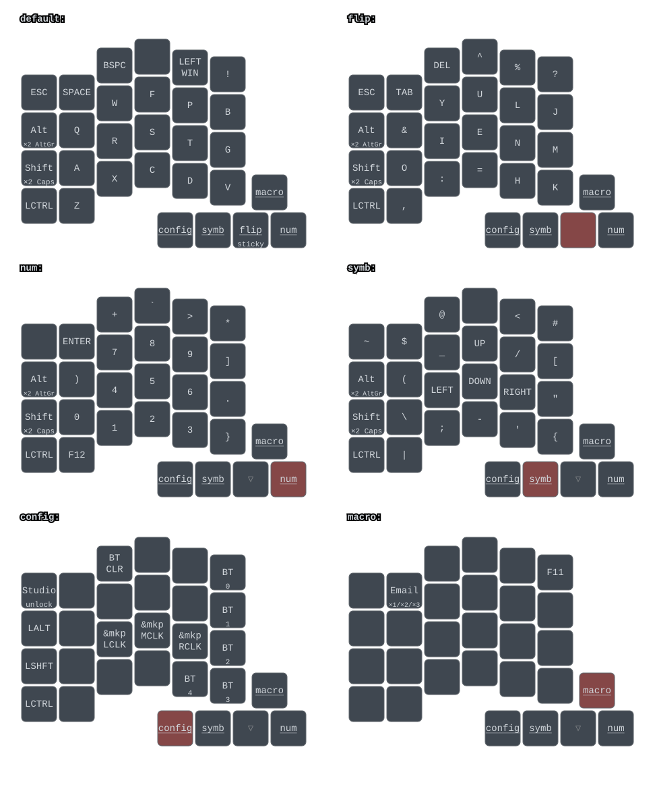

# Key-B firmware

This keyboard is based on [ZMK](https://zmk.dev/) and the [Adafruit nRF2 bootloader](https://github.com/adafruit/Adafruit_nRF52_Bootloader)

## ZMK 

This firmware works with the custom board defined at [Key-B hardware](https://github.com/SaidAlvarado/leftboard-hardware).
And this repository works with the [ZMK github-action template](https://github.com/zmkfirmware/unified-zmk-config-template). So it compiles on the cloud on a github-actions workflow.

### Keymap



This drawing is generated by [keymap-drawer](https://github.com/caksoylar/keymap-drawer), with a PNG copy in `keymap-drawer/keyb.png`.
The `Draw keymap` workflow (`.github/workflows/draw.yml`) redraws both and commits them back whenever
`config/keyb.keymap`, the physical layout or `keymap_drawer.config.yaml` change.
The key shapes come from `boards/saidalvarado/keyb/keyb-layout.dtsi`, generated from the switch positions
in the PCB, and the labels for the custom behaviors are set in `keymap_drawer.config.yaml`.

To draw it locally:
```
pipx install keymap-drawer
keymap -c keymap_drawer.config.yaml parse -z config/keyb.keymap > keymap-drawer/keyb.yaml
keymap -c keymap_drawer.config.yaml draw keymap-drawer/keyb.yaml -d boards/saidalvarado/keyb/keyb-layout.dtsi -o keymap-drawer/keyb.svg
rsvg-convert -b '#22272e' -z 1.5 keymap-drawer/keyb.svg -o keymap-drawer/keyb.png
```

### ZMK version

ZMK is pinned in `config/west.yml` (and the matching ref in `.github/workflows/build.yml`) to a
specific commit of ZMK `main`, which runs on Zephyr 4.1. To upgrade, change both refs together,
ideally to a release tag such as `v0.4` once it exists. See [pinning ZMK](https://zmk.dev/blog/2025/06/20/pinned-zmk).

### Folder Structure
The `highlighted files` are the modified ones, the rest are the same as the template.

```
.github/
└── workflows/
    └── build.yml
boards/
├── shields
└── saidalvarado/
    └── `keyb/`
        ├── `Kconfig.defconfig`
        ├── `Kconfig.keyb`
        ├── `board.cmake`
        ├── `board.yml`
        ├── `keyb.yaml`
        ├── `keyb.zmk.yml`
        ├── `keyb-layout.dtsi`
        ├── `keyb_nrf52840_zmk.dts`
        ├── `keyb_nrf52840_zmk_defconfig`
        ├── `pre_dt_board.cmake`
        └── zmk.code-workspace
config/
├── `keyb.keymap` (keymap file)
└── `west.yml`
zephyr/
└── module.yml
`build.yaml`
```

- `keyb/`: Zephyr hardware model v2 (HWMv2) board definition, modified from the [nice!60 board definition](https://github.com/zmkfirmware/zmk/tree/main/app/boards/nicekeyboards/nice60). The board ID is `keyb//zmk`.
- `keyb-layout.dtsi`: Physical position of each key, used by keymap-drawer (and ZMK Studio).
- `keyb.keymap`: Keymap file for the keyboard.
- `build.yaml`: Builds the `keyb//zmk` board, a `settings_reset` image, a USB-logging debug image and a ZMK Studio image.

We are not using a shield with a standard board, so we leave the `shields` folder empty.

### UF2

Pushing code to this repository will trigger a github-actions workflow that will compile ZMK with the configuratin defined in the repo.
You can find the resulting [UF2](https://github.com/adafruit/Adafruit_nRF52_Bootloader#adafruit-nrf52-bootloader) binary [here](https://github.com/SaidAlvarado/leftboard-firmware/actions), in the corresponding workflow tab.

The `firmware.zip` artifact contains:
- `keyb__zmk-zmk.uf2`: the normal firmware.
- `settings_reset-keyb__zmk-zmk.uf2`: wipes all stored settings and BLE bonds.
- `keyb-zmk-usb-logging.uf2`: the normal firmware plus logging over USB serial, for debugging.
- `keyb-zmk-studio.uf2`: the normal firmware plus [ZMK Studio](https://zmk.dev/docs/features/studio), to edit the keymap live from <https://zmk.studio> over USB or BLE. Unlock it first with the `Studio unlock` key (CONFIG + Esc). Edits made in Studio are stored on the keyboard and are not reflected in `config/keyb.keymap` or the keymap drawing.

### Flashing

1. Enter the bootloader (double click reset, or ESC + Reset). A `KEY_B` USB drive shows up.
2. Copy the `.uf2` file to the drive. The keyboard reboots when the copy finishes.

After a ZMK upgrade, or when BLE profiles misbehave, start from a clean state:
1. Flash `settings_reset-keyb__zmk-zmk.uf2` and wait a few seconds.
2. Flash `keyb__zmk-zmk.uf2`.
3. On every computer/phone, remove ("forget") the keyboard from the Bluetooth device list, then pair it again on its profile (`&bt BT_SEL n` on the config layer).

## Adafruit nRF Bootloader

### Using the Bootloader
Official instructions, here: [Adafruit nRF2 bootloader](https://github.com/adafruit/Adafruit_nRF52_Bootloader)

- BootLoader Mode:
  - Double click reset button
  - ESC + Reset

### Building the Bootloader
I have a fork of the original Adafruit Bootloader [here](https://github.com/SaidAlvarado/Adafruit_nRF52_Bootloader). It is already configured with the information of the Key-B board.

it also has a [fix](https://github.com/adafruit/Adafruit_nRF52_Bootloader/pull/321) for working with gcc version 13

Clone, and Init the repo

```
git clone https://github.com/SaidAlvarado/Adafruit_nRF52_Bootloader
cd Adafruit_nRF52_Bootloader
git submodule update --init
git fetch --tags
```
Build the Key-B board
```
make BOARD=key_b all
```

### Flash the Bootloader
Once the project is built you can find a `uf2` binary in:
```
Adafruit_nRF52_Bootloader/_build/build-key_b/update-key_b_bootloader-0.8.3_nosd.uf2
```

This can be thrown in the `UF2` upgrade folder like any other firmware and it should work.

